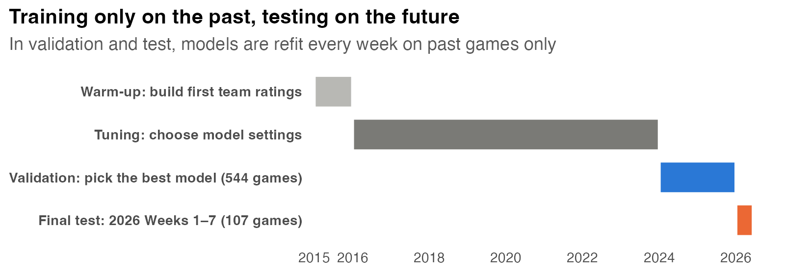
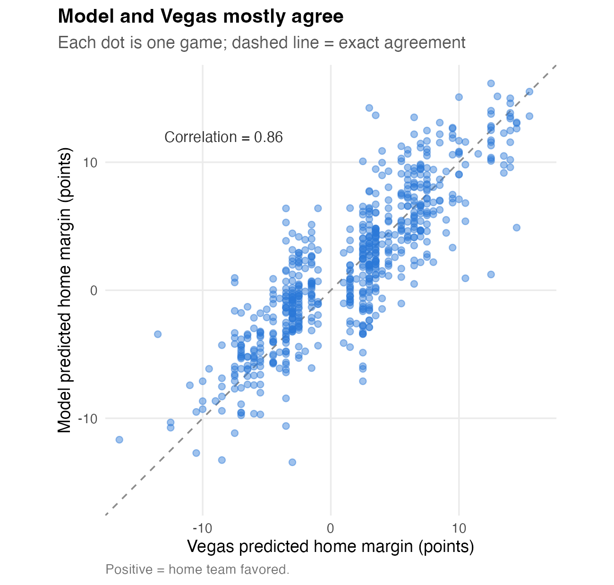
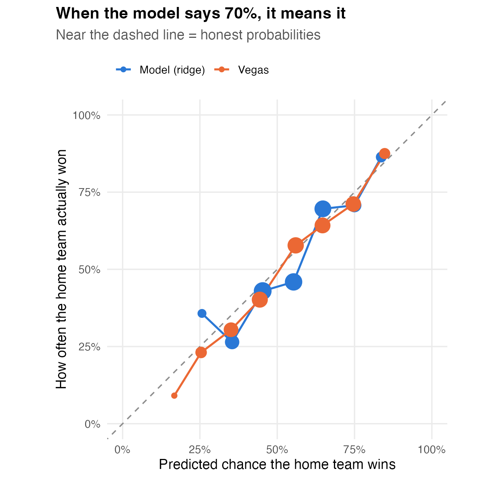
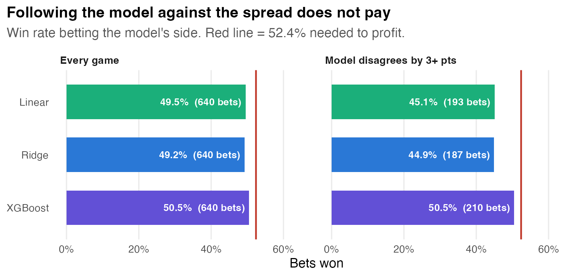
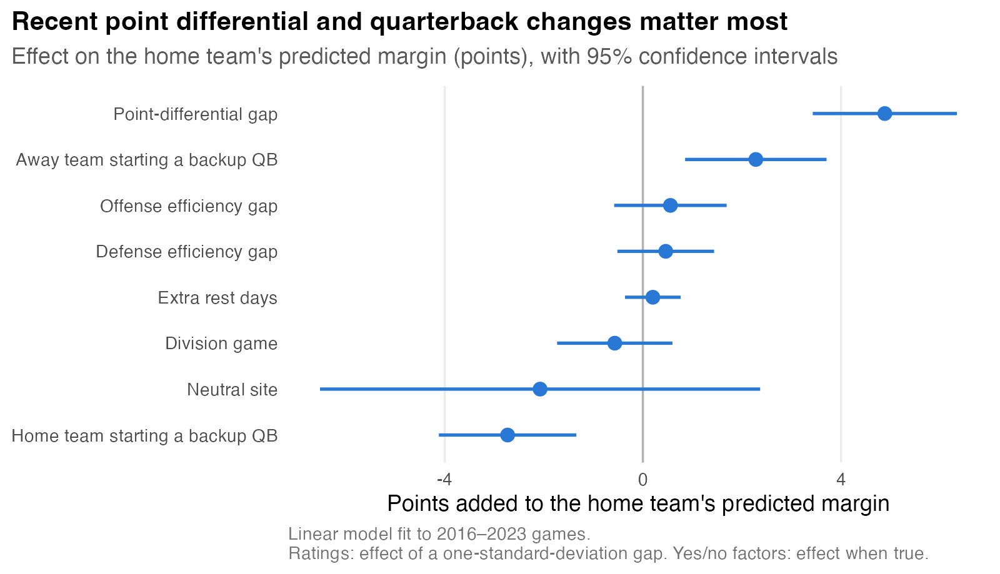
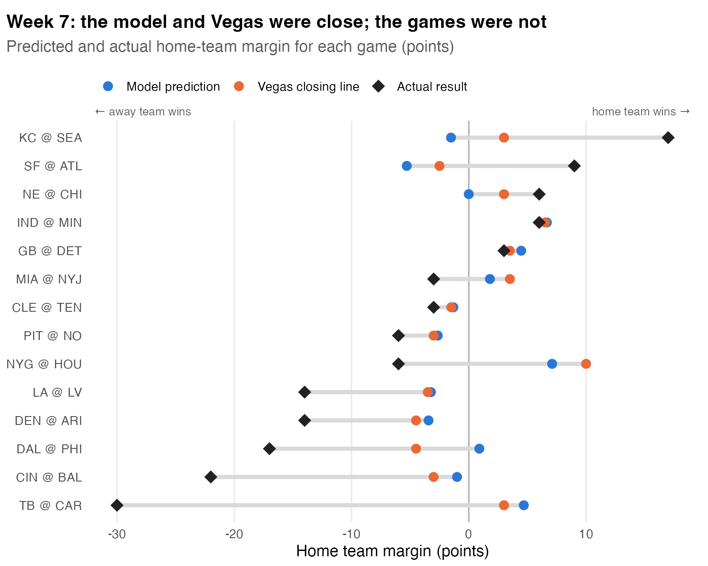
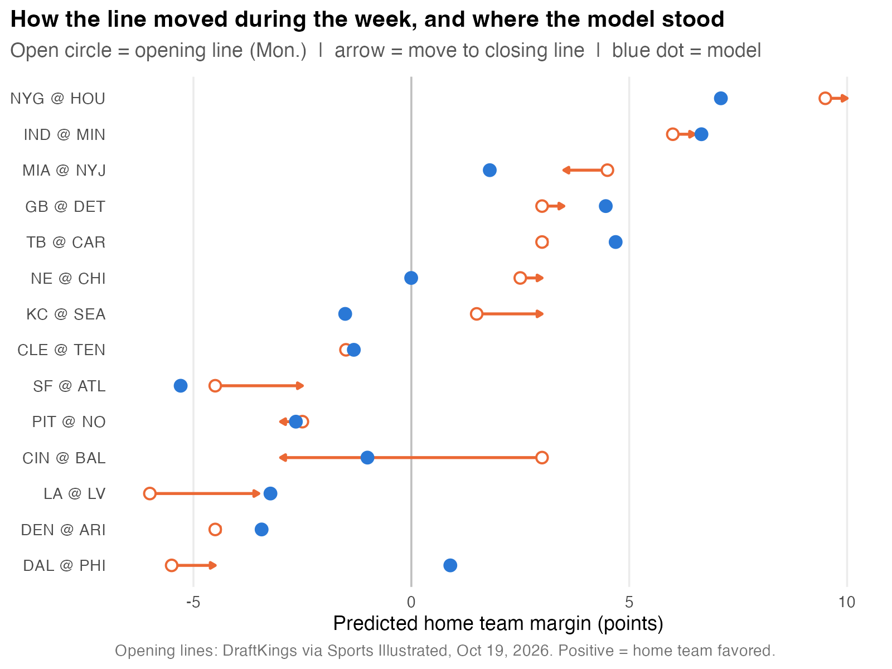

# Can a Homemade Model Keep Up With Vegas?
## Forecasting NFL Games With Public Data and Testing Against the Betting Market, 2024–2026

---

## Executive Summary

Sportsbooks publish a prediction for every NFL game, and decades of research show those predictions are extremely hard to beat. This analysis asks a practical question for any organization considering its own forecasting tool: **how close can a transparent model built only from free, public data get to the Vegas betting line?**

I built a model that predicts the score of every NFL game, then tested it on **651 games** from the 2024 season through Week 7 of 2026. Every prediction was made using only games that had already been played, the same way a real forecaster has to work.

| Forecast | Winners picked | Avg. miss on final margin |
|---|---|---|
| Always pick the home team | 52.5% | 10.92 pts |
| **My model (ridge regression)** | **63.3%** | **10.03 pts** |
| Vegas closing line | 67.6% | 9.62 pts |

**Primary finding:** the model closes most of the gap between guessing and Vegas, finishing **about 0.4 points per game behind the betting market**. That gap is small but statistically real (p < 0.001). The model's win probabilities are well calibrated, and a more complex machine-learning model (XGBoost) did no better than a simple regression. Betting on the model's disagreements with Vegas would have lost money.

**Recommendation:** treat the betting market as the benchmark, and use in-house models for what the market cannot provide: explanations of *why* a team is favored, forecasts before lines are posted, and probabilities that feed season simulations, playoff odds and fantasy projections.

---

## Introduction & Business Context

Every NFL game comes with three numbers from the sportsbooks:

- **Point spread:** the predicted margin of victory. "Lions -3.5" means the Lions are expected to win by about 3.5 points.
- **Total (over/under):** the predicted combined score.
- **Moneyline:** betting odds for picking the outright winner, which can be converted into each team's chance of winning.

These lines are set by professionals and then adjusted by millions of dollars in bets until kickoff. That makes them a free, public and very strong forecast, and academic research finds the NFL betting market close to efficient (Gandar et al., 1988; Levitt, 2004).

For a team analytics department, a sports media company or a fantasy platform, that creates a real decision: **is it worth building our own forecasting model, or should we simply use the betting line?** This analysis answers four questions:

1. How close can a transparent, public-data model get to Vegas?
2. Does a more complex model do better than a simple one?
3. When the model disagrees with Vegas, is it ever right in a way that matters?
4. What does the model look like on a real week of games? (2026 Week 7)

---

## Methodology

### Data

All data come from the open-source **nflverse** project, downloaded with the `nflreadr` R package:

- **Game results and closing betting lines** for every regular-season game from 2015 through 2026 Week 7 (Lee Sharpe's nfldata).
- **Play-by-play data** (about 500,000 plays) with expected points added, or EPA, a per-play measure of how much each play helped a team's chances of scoring (nflfastR).
- **Week 7 2026 opening lines**, hand-collected from DraftKings as published by *Sports Illustrated* on October 19, 2026.

### What the model knows about each team

Before every game, the model summarizes each team's **previous games only**:

- **Offensive and defensive efficiency** (EPA per play, ignoring garbage time in blowouts)
- **Point differential:** how much a team has been outscoring opponents
- **Points scored and allowed**, for predicting totals

Recent games count more than older ones, and last season carries over at half weight so early-season ratings start from last year's form. The model also knows the context of each game: whether either team is **starting a backup quarterback** (a simple stand-in for the most important injury in football), **rest days**, **division games**, **neutral sites**, **domes**, **weather** and the **league-wide scoring trend**.

### Four models, from simplest to most complex

| Model | Description |
|---|---|
| Baseline | Always predicts the home team wins by the average home-field edge (about 2 points) |
| Linear regression | Combines team ratings and context, with weights learned from past games |
| Ridge regression | Linear regression that keeps any one weight from growing too large, which helps when inputs overlap (Hoerl & Kennard, 1970) |
| XGBoost | A machine-learning model built from many small decision trees (Chen & Guestrin, 2016) |

Each model predicts the **margin** and the **total**. From those two numbers come a predicted score, a winner, a point spread, and a win probability. The win probability uses Stern's (1991) finding that NFL margins fall in a bell curve around the predicted margin, spread out by about 13–14 points.

### Testing without seeing the future

The most important rule in sports forecasting is that a model must never learn from games that happen after the one it is predicting. The data were split strictly by time:

- **Tuning (2016–2023):** model settings were chosen with season-ahead cross-validation: train on all earlier seasons, test on the next one (Hyndman & Athanasopoulos, 2021).
- **Validation (2024–2025, 544 games):** each week, every model was retrained on all earlier games and predicted that week's games. These results chose the final model.
- **Final test (2026 Weeks 1–7, 107 games):** the same process, run once on games never used to choose the model.

Every result below uses this **walk-forward** approach.

---

## Results

### 1. The models close most of the gap to Vegas

Always picking the home team gets about half the winners right. Adding team ratings raises that to about 63%, close to Vegas's 68%. The three real models perform almost identically; XGBoost is ahead by less than a tenth of a point, far less than normal season-to-season noise (about 0.4 points).

| Period | Model | Avg. margin miss | Winners picked | Brier score |
|---|---|---|---|---|
| Validation (2024–25) | Ridge | 10.08 | 64.5% | 0.218 |
| | Vegas | 9.67 | 68.3% | 0.206 |
| Final test (2026 Wks 1–7) | Ridge | 9.82 | 57.5% | 0.239 |
| | Vegas | 9.41 | 64.2% | 0.233 |

*Brier score grades probability forecasts from 0 (perfect) to 0.25 (coin flip); lower is better.*

Because the models were statistically tied, I selected **ridge regression** using the one-standard-error rule: when models perform within noise of each other, choose the simplest (Hastie, Tibshirani & Friedman, 2009). Ridge is as easy to explain as linear regression and more stable when its inputs overlap.

### 2. Vegas is better, but by less than half a point

The model and Vegas agree closely on most games (correlation of 0.86). Comparing both forecasts on the same 651 games with a paired t-test, the model misses the final margin by **0.41 more points per game** (95% CI: 0.19 to 0.63, p < 0.001). Vegas is genuinely better, but only slightly, and the model was closer to the final result in **45% of individual games**.

### 3. The model's probabilities are trustworthy

A forecast is **calibrated** when its percentages come true at the stated rate. Both the model and Vegas stay close to the diagonal: when the model gives a team a 70% chance, that team wins about 70% of the time. Vegas's advantage is that it is willing to make more confident calls (more games near 20% or 80%), and those calls hold up.

### 4. Betting on the model's disagreements would lose money

After the sportsbook's cut, a bettor must win **52.4%** of spread bets to break even. Betting the side the model preferred won **49.2%** of 640 bets, and only **44.9%** when the model disagreed with Vegas by three or more points. No version of the model clears the break-even line in a meaningful way.

### 5. What drives the predictions

The strongest factor is **how much better one team has been recently**, measured by point differential. **Starting a backup quarterback** is next: it costs a team roughly 2 to 3 points, consistent with how sportsbooks adjust for quarterback injuries. The two efficiency measures overlap heavily with point differential, so their separate effects are uncertain, which is the situation ridge regression is designed for.

### 6. Spotlight: 2026 Week 7

Week 7 shows what this looks like on a real slate. It was a difficult week to forecast: Tampa Bay won by 30 as an underdog, and Cincinnati won by 22 when the line was 3.

| Week 7 (14 games) | Model | Vegas |
|---|---|---|
| Winners picked | 7 of 14 | 10 of 14 |
| Avg. miss on margin | 11.3 pts | 10.1 pts |
| Avg. miss on total | **10.1 pts** | 10.4 pts |

Vegas picked more winners, while the model was slightly more accurate on the combined score.

The betting line moved during the week in 11 of 14 games, and in **7 of those 11** it moved toward the model's number. The clearest case was **Bengals @ Ravens**: the line opened with Baltimore favored by 3 and closed with Cincinnati favored by 3 after Baltimore's quarterback situation changed. Using only Week 6 information, the model already had Cincinnati as a slight favorite because its quarterback-change flag detected Baltimore's backup starter. Cincinnati won 35–13. One week is a small sample, but it shows the model captures real information rather than copying the opening line.

---

## Recommendations

### For team and athletics analytics departments
- **Use the betting line as the benchmark** for any game-level forecast. A model that cannot get within about half a point of the closing line is missing information.
- **Use in-house models for explanation, not just prediction.** A transparent model shows *why* a team is favored (recent form, quarterback availability, rest), which a betting line cannot.
- **Build on the probabilities.** Calibrated win probabilities are the input for season simulations, playoff odds and decision tools.

### For media and fantasy platforms
- **Publish model forecasts before lines open.** The model produces full predictions (scores, spreads, totals, win probabilities) as soon as the previous week ends.
- **Use predicted totals as a "game environment" signal** for fantasy projections. High-scoring matchups produce more fantasy points, and the model was competitive with Vegas on totals in Week 7.

### For bettors
- **Do not expect a public-data model to beat closing lines.** Over 640 games, following the model won 49.2% of spread bets, below the 52.4% needed to profit.
- **Watch line movement instead.** In Week 7, the line moved toward the model's number in 7 of 11 games, suggesting models like this are more useful for anticipating early-week line movement than for beating the final number.

---

## Limitations & Assumptions

- **The benchmark is the closing line,** which includes late injury news, weather forecasts and professional bets an earlier forecast would not have. This makes the comparison harder for the model, not easier.
- **Weather is "known" in historical games.** Training uses recorded weather rather than forecasts; 2026 games use each stadium's typical weather for that month.
- **Quarterback changes use the starter listed in the data.** Most starters are announced days ahead, but last-minute changes would be missed.
- **No player-level injury model.** Only quarterback changes are captured; injuries to linemen, receivers or defenders are not.
- **Week 7 is only 14 games.** It illustrates the model in action; the 651-game evaluation is the evidence.

---

## Conclusions

A transparent model built entirely from free, public NFL data gets **within half a point per game of the Vegas closing line**, produces honest win probabilities, and picks about 63% of winners versus about 68% for Vegas. More complexity did not help: a machine-learning model performed no better than a simple regression. And consistent with decades of research, the model does not beat the betting market.

The value of a model like this is not in beating Vegas; it is in **explaining games, forecasting before lines exist, and powering downstream tools** such as season simulations and playoff odds. For any organization deciding whether to build its own forecasting system, the betting market is the right benchmark, and this analysis shows how close a well-tested, public-data model can get.

---

## Technical Specifications

- **Language & tools:** R, Quarto, tidyverse, tidymodels, glmnet, xgboost, gt, ggplot2
- **Data:** nflverse (`nflreadr::load_schedules()`, `nflreadr::load_pbp()`), 2015–2026 Week 7; Week 7 opening lines hand-collected
- **Features:** exponentially weighted team ratings (decay 0.90 per game, 0.50 per offseason) for EPA per play, point differential and points scored/allowed; quarterback-change flag; rest, division, neutral site, dome, wind, temperature, league scoring trend
- **Models:** baseline, linear regression, ridge regression (glmnet), XGBoost; separate models for margin and total
- **Tuning:** season-ahead cross-validation, 2019–2023 assessment seasons
- **Evaluation:** weekly walk-forward refitting; validation 2024–2025 (544 games), final test 2026 Weeks 1–7 (107 games)
- **Metrics:** mean absolute error, winner accuracy, Brier score, calibration, paired t-test vs. Vegas, against-the-spread win rate
- **Win probability:** normal approximation, P(win) = Φ(predicted margin / residual SD)
- **Reproducibility:** `01_get_data.R` downloads and saves data snapshots; fixed random seed; `sessionInfo()` recorded in the notebook

---

## References

- Brier, G. W. (1950). Verification of forecasts expressed in terms of probability. *Monthly Weather Review, 78*(1), 1–3.
- Carl, S., & Baldwin, B. *nflfastR* [R package]. https://www.nflfastr.com/
- Chen, T., & Guestrin, C. (2016). XGBoost: A scalable tree boosting system. *Proceedings of the 22nd ACM SIGKDD International Conference on Knowledge Discovery and Data Mining*, 785–794.
- Diebold, F. X., & Mariano, R. S. (1995). Comparing predictive accuracy. *Journal of Business & Economic Statistics, 13*(3), 253–263.
- Gandar, J., Zuber, R., O'Brien, T., & Russo, B. (1988). Testing rationality in the point spread betting market. *The Journal of Finance, 43*(4), 995–1008.
- Hastie, T., Tibshirani, R., & Friedman, J. (2009). *The Elements of Statistical Learning* (2nd ed.). Springer.
- Ho, T., & Carl, S. *nflreadr* [R package]. https://nflreadr.nflverse.com/
- Hoerl, A. E., & Kennard, R. W. (1970). Ridge regression: Biased estimation for nonorthogonal problems. *Technometrics, 12*(1), 55–67.
- Hyndman, R. J., & Athanasopoulos, G. (2021). *Forecasting: Principles and Practice* (3rd ed.). OTexts. https://otexts.com/fpp3/
- Levitt, S. D. (2004). Why are gambling markets organised so differently from financial markets? *The Economic Journal, 114*(495), 223–246.
- Petrella, S. (2021, updated 2026). How to remove juice/vig from sports betting odds. *Action Network*.
- Sharpe, L. *nfldata* [Data repository]. https://github.com/nflverse/nfldata
- Stern, H. (1991). On the probability of winning a football game. *The American Statistician, 45*(3), 179–183.
- *Sports Illustrated* Betting (2026, October 19). NFL Week 7 opening odds for every game.
