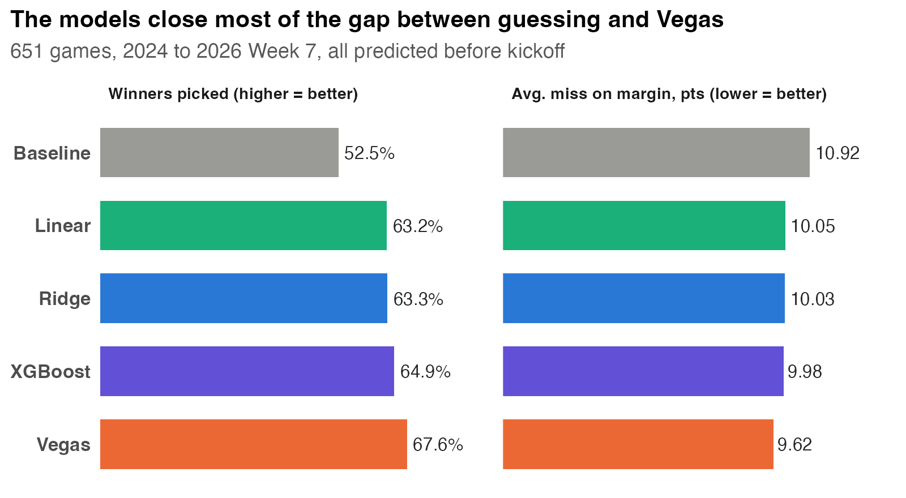

# Can a Homemade Model Keep Up With Vegas?
## Forecasting NFL Games With Public Data and Testing Against the Betting Market
## Independent Project | 2026

### Project Overview
Sportsbooks publish a prediction for every NFL game, and those predictions are famously hard to beat. This project asks how close a transparent model built only from free, public data can get. I built a model that predicts the score, winner, point spread and win probability for every NFL game, then tested it on **651 games** (2024 through Week 7 of 2026) against the Vegas betting line. Every prediction was made using only games that had already been played.

📊 **[View Rendered Analysis](https://cooper-woods.github.io/portfolio/08_NFL_Game_Prediction/NFL_Game_Prediction.html)** | 📄 **[Read the Full Report](./08_NFL_Game_Prediction_Report.md)**

### Business Problem
Team analytics departments, sports media companies and fantasy platforms all face the same decision: build their own forecasting model, or rely on the betting line? This project answers:
1. How close can a transparent, public-data model get to Vegas?
2. Does a more complex model (XGBoost) beat a simple regression?
3. When the model disagrees with Vegas, is it ever right in a way that matters?
4. How does the model look on a real week of games? (2026 Week 7)

### Key Findings
- **Close, but Vegas still wins:** the model missed the final margin by 10.03 points per game vs. 9.62 for Vegas, a gap of 0.41 points that is statistically significant (paired t-test, p < 0.001)
- **Winners picked:** 63.3% for the model vs. 67.6% for Vegas and 52.5% for always picking the home team
- **Complexity didn't help:** linear regression, ridge regression and XGBoost performed within a tenth of a point of each other
- **Trustworthy probabilities:** the model's win probabilities are well calibrated (a 70% pick wins about 70% of the time)
- **No betting edge:** following the model against the spread won 49.2% of 640 bets, below the 52.4% break-even
- **Biggest drivers:** recent point differential and starting a backup quarterback (worth roughly 2–3 points)
- **Week 7 spotlight:** the betting line moved toward the model's number in 7 of the 11 games where it moved

### Methods

**Data Engineering:** Aggregated about 500,000 plays into team-game efficiency stats (EPA per play), then built exponentially weighted team ratings from previous games only

**Feature Engineering:** Offensive/defensive efficiency, point differential, quarterback-change flag (injury proxy), rest, division, neutral site, dome, weather and league scoring trend

**Modeling:** Four models predicting margin and total points: home-field baseline, linear regression, ridge regression and XGBoost (tidymodels)

**Time-Aware Validation:**
- Season-ahead cross-validation for tuning (2016–2023)
- Weekly walk-forward refitting for validation (2024–2025) and a final held-out test (2026 Weeks 1–7)
- Model selection with the one-standard-error rule

**Evaluation Against Vegas:**
- Mean absolute error, winner accuracy, Brier score and calibration
- Paired t-test of model vs. Vegas errors on the same games
- Converting predictions into point spreads, win probabilities and moneyline odds, with the sportsbook's vig removed from Vegas odds
- Against-the-spread betting test and opening-to-closing line movement analysis

**Skills Demonstrated:**
- Forecasting with strict prevention of data leakage
- Regression, regularization (ridge) and gradient boosting
- Probability calibration and proper scoring rules
- Statistical comparison of forecasts
- Sports betting market concepts (spreads, totals, moneylines, vig, line movement)
- Reproducible data pipelines and clear communication for non-technical audiences

### Files in This Folder
- `NFL_Game_Prediction.qmd` — Source code (executable Quarto notebook)
- `NFL_Game_Prediction.html` — Rendered analysis
- `08_NFL_Game_Prediction_Report.md` — Full professional analysis report
- `01_get_data.R` — Downloads and prepares the data
- `data/` — Data snapshots used in the analysis
- `figures/` — Key charts used in the report
- `output/week7_predictions.csv` — Week 7 predictions, odds and results
- `README.md` — This file

### Data Sources

**Game Results & Betting Lines:**
- nflverse / Lee Sharpe, *nfldata*
- https://github.com/nflverse/nfldata
- Accessed with `nflreadr::load_schedules()`
- Final scores, closing spreads, totals and moneylines, rest days, stadium roof, weather and starting quarterbacks, 2015–2026

**Play-by-Play Data:**
- nflverse / nflfastR (Carl & Baldwin)
- https://github.com/nflverse/nflverse-data
- Accessed with `nflreadr::load_pbp()`
- Every play since 2015 with expected points added (EPA)

**Week 7 Opening Lines:**
- DraftKings, as published by *Sports Illustrated* (October 19, 2026)
- Hand-collected; source URL recorded in `data/week7_opening_lines.csv`

### How to Run
1. Open `NFL_Game_Prediction.qmd` in RStudio
2. (Optional) Run `01_get_data.R` to download fresh data; requires `install.packages("nflreadr")`
3. Click "Render"; required packages install automatically
4. Output will generate as HTML (first render takes about two minutes)

### What I Learned
- How sports betting lines work, and how to turn odds into fair probabilities by removing the vig
- Why forecasting requires time-aware validation instead of random cross-validation
- How to evaluate probability forecasts with calibration and Brier scores, not just accuracy
- That a simpler, explainable model can match a complex one when the signal is limited
- How to benchmark a model honestly against a strong existing forecast
- How to explain statistical results to readers without a statistics background

---

**For Sports Analytics:** Shows the full forecasting workflow used by team and media analytics groups: building ratings from play-by-play data, producing calibrated win probabilities, and benchmarking against the betting market.

### For Graduate Programs (MS Data Science)

This project applies statistical learning and forecast evaluation to a real, noisy prediction problem with a world-class benchmark.

Key graduate-level competencies demonstrated:

- **Forecasting methodology:** Walk-forward evaluation and season-ahead cross-validation that prevent future information from leaking into predictions
- **Statistical learning:** Comparing linear, regularized (ridge) and tree-based (XGBoost) models, and selecting among them with the one-standard-error rule
- **Probabilistic prediction:** Converting point predictions into calibrated probabilities using a normal margin model (Stern, 1991) and evaluating them with proper scoring rules
- **Rigorous comparison:** Paired testing against a strong benchmark rather than reporting accuracy in isolation
- **Communication:** Presenting technical results for decision-makers, with plain-language explanations and recommendations

*Analysis completed: October 2026*
